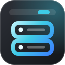

<div align="center">
  
  <h1>Server Dashboard</h1>
  <p>A server in the Omarchy bar, over <b>SSH</b>, built for machines on <b>Tailscale</b>:<br/>
  live CPU, memory, disks, temperature and network, <b>Docker</b> containers and failed services, with restart, reboot and terminal actions.</p>
  <p>
    
    
    
    <a href="https://github.com/T3lluz/omarchy-server-dashboard/actions/workflows/ci.yml"></a>
    
  </p>
  <p><a href="#install"><b>Install</b></a> · <a href="#features">Features</a> · <a href="#connect">Connect</a> · <a href="#settings">Settings</a> · <a href="#security">Security</a></p>
</div>

## Features

- **The bar shows what you pick:** a server mark with CPU and RAM by default, plus root disk, CPU temperature and network rates, or none. The mark turns urgent when the server is unreachable or something needs you.
- **A compact panel:** CPU, RAM, root disk and temperature dials; network rates, load and running containers on one line; alerts; failed systemd services with restart; and SSH, btop, reboot and power off.
- **More** (or `e`) expands it with CPU, memory, download and upload history graphs, system facts (OS, kernel, CPU, load, swap, tasks, uptime, reboot required), every real filesystem, Docker containers with start, stop and restart, and the top processes. It reopens the way you left it.
- **Notifications:** one when the server stops answering and one when it is back, and one for each new problem: a container turning unhealthy or restart-looping, a filesystem passing 90%, a systemd unit failing. Starting the shell never notifies about what was already wrong.
- **Nothing on the server:** every poll is one shell command reading `/proc`, `/sys`, `df`, `ps`, `docker` and `systemctl`, over a single multiplexed SSH session, so the server sees one login rather than one every few seconds.
- **Every monitor agrees:** the bar draws the widget once per screen; the first owns the connection, the others mirror it, and all of them read their settings straight from `shell.json`.
- Colours, fonts, corners and spacing come from the active Omarchy theme.

## Install

```bash
omarchy plugin add https://github.com/T3lluz/omarchy-server-dashboard.git --enable
```

Needs `openssh`, `secret-tool` (libsecret) with a running keyring, and `jq`; `tailscale` for the machine list and the "Tailscale is off" hint. The server needs `sshd`; the Docker and systemd sections appear when it has them.

## Connect

Click the bar icon. The panel opens on a connect form:

1. Type `user@host`, for example `casaos@100.64.0.10`. Online machines on your tailnet are listed under the form; click one to fill in its address.
2. Type the password and press Enter, or leave it empty to use your SSH keys.

The password is stored in your keyring (GNOME Keyring, via `secret-tool`) and handed to `ssh` through `SSH_ASKPASS`. It never appears in `shell.json`, in a command line, or on disk.

## Use

| Input | Action |
|-------|--------|
| Left click | Open or close the dashboard |
| Middle click | Refresh now |
| Right click | SSH shell on the server |
| `j` / `k`, arrows | Move between containers, services and actions |
| `enter` | Restart the selected container or service, or run the action |
| `s` | Start or stop the selected container |
| `e` | Expand or collapse |
| `t` / `b` | SSH shell / btop (falls back to htop, then top) |
| `r` | Refresh |
| `c` | Settings: bar stats, alerts, panel and connection |
| `esc` | Close |

Reboot, power off and service restarts use `sudo` on the server, fed the saved password. Container actions try `docker` first and fall back to `sudo`.

## Settings

The ⚙ button in the panel (or `c`) opens them. They are saved in the widget's entry in `~/.config/omarchy/shell.json`, and can be set from a terminal too, for example `omarchy bar set io.github.t3lluz.server-dashboard barTemp true --json`:

| Key | Default | Meaning |
|-----|---------|---------|
| `target` | | `user@host` |
| `port` | `22` | SSH port |
| `displayName` | | Shown instead of the server's hostname |
| `refreshIntervalSec` | `5` | Seconds between polls (2 to 120) |
| `barCpu` | `true` | CPU usage in the bar |
| `barRam` | `true` | Memory usage in the bar |
| `barDisk` | `false` | Root disk usage in the bar |
| `barTemp` | `false` | CPU temperature in the bar |
| `barNetwork` | `false` | Download and upload rates in the bar |
| `notify` | `true` | Desktop notifications for outages and new alerts |
| `panelExpanded` | `false` | Open the panel expanded |

With every `bar*` stat off the widget polls every 30 seconds while the panel is closed, enough to colour the icon and notify.

## Commands

```bash
omarchy-shell io.github.t3lluz.server-dashboard toggle     # open on the focused monitor; open | close
omarchy-shell io.github.t3lluz.server-dashboard settings
omarchy-shell io.github.t3lluz.server-dashboard refresh
omarchy-shell io.github.t3lluz.server-dashboard status     # JSON: connection, CPU, memory, uptime
```

## Security

- Host keys are trusted on first use and pinned in `~/.local/state/omarchy-server-dashboard/known_hosts`. A changed key stops the connection before the password is sent; the panel then offers to trust the new key, which you should accept only if you reinstalled the server.
- A wrong password stops polling instead of retrying, so the widget will not trigger fail2ban.
- The multiplexed session socket lives in `$XDG_RUNTIME_DIR`, readable only by you, and closes after 10 minutes without use.

## Development

```bash
node tests/model.test.js
bash -n bin/server-dash
omarchy plugin validate .
omarchy restart shell    # pick up QML changes
```

`Model.js` parses the probe and holds the alert rules, tested under node; `bin/server-dash` is the SSH side. See [AGENTS.md](AGENTS.md) for how the pieces fit.

## License

MIT

One of a set of Omarchy plugins: [Batteries](https://github.com/T3lluz/omarchy-batteries) · [ROG Deck](https://github.com/T3lluz/omarchy-rog-deck) · [Sonus](https://github.com/T3lluz/omarchy-sonus) · **Server Dashboard**
